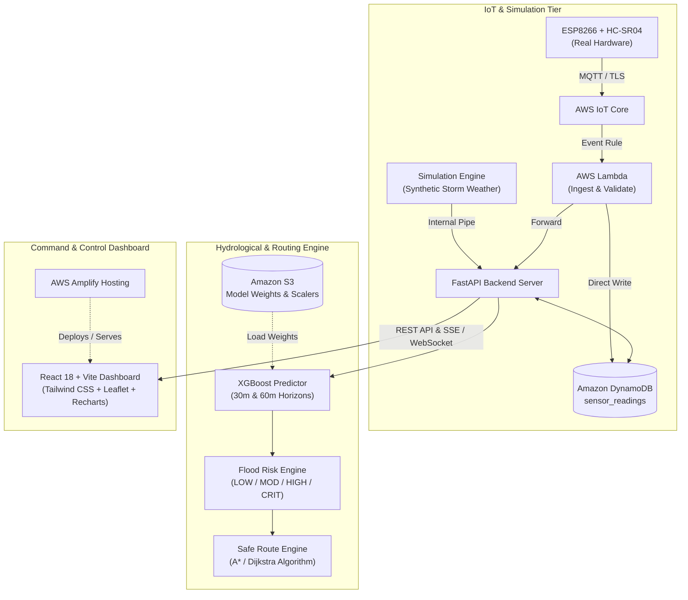
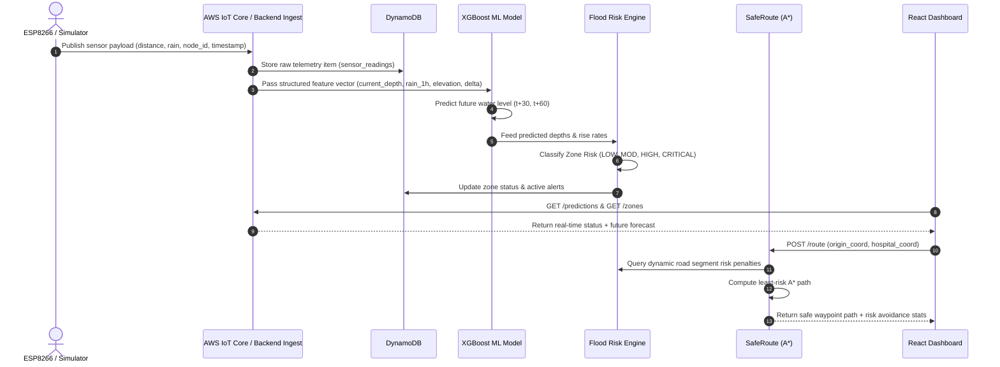
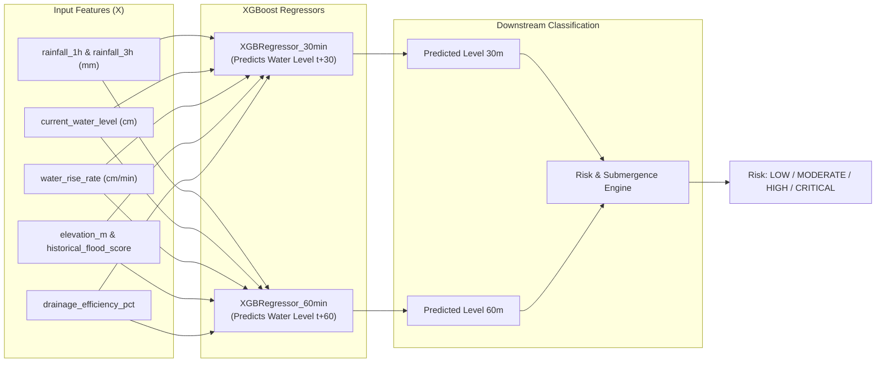
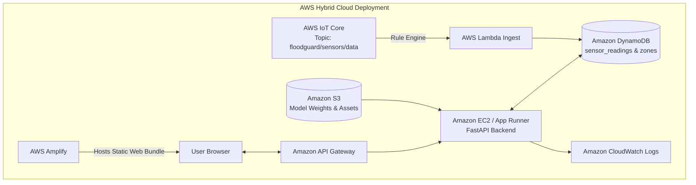

# FLOODGUARD — Complete Technical Implementation Plan
## AI-Powered Urban Flood Prediction, Early Warning, and Safe Emergency Routing System

**Hackathon Track:** Track 02 — Heat and Water (Monsoon Waterlogging & Flooding Focus)  
**Target Environment:** Local & AWS Cloud Hybrid (AWS Open Source & AWS Cloud Services)  
**Document Version:** 1.0.0  
**Target Architecture:** Production-Ready Hackathon Prototype  

---

## 1. Project Overview

**FloodGuard** is an intelligent, end-to-end urban flood forecasting, real-time warning, and emergency evacuation navigation platform designed for city disaster management agencies, emergency responders, and urban citizens.

Unlike passive flood tracking systems that record flooding only after intersections submerge, FloodGuard bridges real-time sensor streams and meteorology with an **AI-driven hydrological predictive engine**. It forecasts road-level water levels **30 to 60 minutes into the future**, calculates dynamic risk indices, projects zone danger boundaries onto an interactive situational awareness dashboard, and dynamically recalibrates emergency vehicle routes (A* / Dijkstra cost graphs) to navigate ambulances and rescue vehicles around impassable routes.

Crucially, FloodGuard operates seamlessly in **Dual-Mode (Real Hardware + Autonomous Simulation Engine)**, guaranteeing a zero-downtime, fault-tolerant hackathon demonstration regardless of IoT network connectivity or physical testbench states.

```
+----------------------------------------------------------------------------------------------------+
|                                      FLOODGUARD SYSTEM VISION                                      |
|                                                                                                    |
|  [ESP8266 / Sim Sensors]                                                                           |
|  [Weather & Elevation]   --> [XGBoost ML] --> [Risk Engine] --> [Early Warnings] --> [Safe Route]  |
|  [Historical Drainage]        (30/60m)         (Low-Crit)         (SMS/UI Alert)     (A* Dijkstra) |
+----------------------------------------------------------------------------------------------------+
```

---

## 2. Problem Statement

Monsoon rainfall in modern urban centers causes flash waterlogging and sudden flooding within 20 to 45 minutes due to:
1. **Concrete Over-Paving & Inadequate Infiltration:** Rapid runoff overwhelms drainage networks.
2. **Lagging Disaster Awareness:** Traditional municipal flood responses rely on post-facto civic complaints or submerged CCTV inspections.
3. **Emergency Gridlock & Ambulatory Stalling:** First responders dispatch along conventional shortest-path routes (Google Maps/OSM) that lack hydrological elevation and live flood telemetry, trapping ambulances in submerged underpasses.
4. **Sensor Fragility:** Physical IoT sensors during storms frequently suffer power loss, RF attenuation, or debris blockage, leaving command teams blind without intelligent fallback models.

---

## 3. Proposed Solution

FloodGuard resolves these systemic failures through a tightly integrated five-tier response:

1. **Hydrological Forecasting Core:** Dual-horizon XGBoost regression forecasting water height ($t+30$ min, $t+60$ min) combining real-time rainfall rate, water-level velocity ($\Delta h / \Delta t$), ambient barometrics, road elevations, and catchment soil saturation.
2. **Dynamic Risk Categorization:** A multi-factor risk scoring engine classifying road segments into `LOW` (<50 cm), `MODERATE` (50–70 cm), `HIGH` (70–90 cm), and `CRITICAL` (>90 cm) danger zones.
3. **Command Dashboard (Situational Center):** A high-performance WebGIS operations console featuring live choropleths, depth trend charts, sensor health badges, and automated proactive alert advisories.
4. **Hydrology-Weighted Evacuation Routing (SafeRoute):** An A*/Dijkstra graph router that dynamically penalizes road segments based on real-time and predicted flood inundation probability, preventing vehicle stranding.
5. **Decoupled Dual-Ingestion Pipeline:** Seamless failover architecture supporting real ESP8266 + HC-SR04 ultrasonic sensor nodes (via AWS IoT Core MQTT) and an algorithmic synthetic storm weather simulator.

---

## 4. Goals

- **Accurate Short-Term Water Forecasting:** Predict road segment water level 30 and 60 minutes ahead with a root mean square error (RMSE) under 6 cm on test data.
- **Resilient Fallback Mode:** Seamless toggle between physical ESP8266 MQTT sensor streams and software simulation engine without UI interruptions or backend restart.
- **Emergency Route Optimization:** Compute and render alternate safe evacuation routes between vehicle coordinate and target trauma center, demonstrating flood avoidance with negligible detour latency (<200 ms calculation time).
- **Proactive Early Warning Dissemination:** Fire actionable threshold alerts with estimated "Time to Critical Level" ($T_{\text{crit}}$) at least 25 minutes prior to road submergence.
- **AWS Cloud Integration & Eligibility:** Incorporate AWS IoT Core, DynamoDB, Lambda, S3, API Gateway, and Amplify Hosting to fully qualify for AWS hackathon tracks.

---

## 5. Non-Goals

- **Full Hydrodynamic 2D Navier-Stokes Simulation:** FloodGuard does not simulate complex 2D shallow water differential equations or sewer pipe physics.
- **Global / Country-Scale Ingestion:** The prototype focuses on a bounded municipal sub-district (e.g., 5 to 15 key urban zones, 30+ road segments).
- **Hard Real-Time RTOS Sub-Millisecond Telemetry:** Sensor data ingest operates on 5-to-15 second cycles, sufficient for stormwater dynamics.
- **Medical Triage or Legally Binding Evacuation Directives:** The system is an emergency decision-support advisory system, not an autonomous legal entity.

---

## 6. User Personas

| Persona | Role | Primary Needs | Key Pain Point |
|---|---|---|---|
| **Municipal Disaster Controller** | City Command Center Officer | Macro-view of city zones, real-time alert triage, 60-min predictive risk maps. | Disjointed sensor dashboards and no advance prediction before roads submerge. |
| **Emergency Ambulance Driver** | First Responder / Paramedic | Turn-by-turn flood-safe routing, clear warnings on blocked underpasses. | Standard navigation apps lead them directly into flooded underpasses. |
| **Field Hydrologist / Urban Engineer** | Maintenance & Analysis Lead | Historical water-level trends, rainfall vs. depth correlation, sensor calibration. | Lack of telemetry reliability and explainable ML factor indicators. |

---

## 7. Core User Stories

- **As a Disaster Controller**, I want to view a real-time choropleth map color-coding zones from Green to Red based on predicted 60-minute water levels so that I can dispatch mobile drainage pumps proactively.
- **As an Emergency Dispatcher**, I want to enter a patient pickup location and hospital destination to receive a route that actively bypasses roads projected to flood above 50 cm.
- **As an Emergency Vehicle Driver**, I want the system to calculate the safe route distance and show the difference in flood exposure percentage compared to the standard shortest route.
- **As a System Administrator**, I want to flip a switch from "Hardware Mode" to "Simulation Mode" during the presentation so that the system remains 100% operational even without WiFi or hardware power.

---

## 8. Key Features Matrix

| Feature | Description | Priority |
|---|---|---|
| **Dual-Mode Telemetry Ingestion** | Accepts ESP8266 ultrasonic readings via MQTT/REST or synthetic sensor streams | **[P0] MVP** |
| **30/60-Min Water Level Predictor** | XGBoost regression predicting depth in cm at 30m and 60m horizons | **[P0] MVP** |
| **Dynamic Risk Classification** | Computes LOW, MODERATE, HIGH, CRITICAL states with configurable thresholds | **[P0] MVP** |
| **Interactive Leaflet Risk Map** | GeoJSON road networks, color-coded risk markers, hospital nodes, zone overlays | **[P0] MVP** |
| **Safe Route Engine (A\*)** | Flood-risk cost weighted graph routing between vehicle and emergency facility | **[P0] MVP** |
| **Real-Time Command Dashboard** | React + Vite UI with Recharts metric trends, alert drawer, scenario slider | **[P0] MVP** |
| **Configurable Simulation Suite** | Sunny, Moderate Monsoon, Flash Flood, and Extreme Cloudburst scenarios | **[P0] MVP** |
| **AWS Cloud Integration** | DynamoDB table storage, S3 model storage, API Gateway endpoints | **[P0] MVP** |
| **Physical ESP8266 IoT Node** | Breadboard ultrasonic sensor node reporting depth to backend via MQTT/HTTP | **[P1]** |
| **Predictive Alert Generator** | Calculates estimated time to critical submergence ($T_{\text{crit}}$) | **[P1]** |
| **Explainable ML (Feature Importance)** | Visual breakdown of top contributing factors (rainfall vs rate vs elevation) | **[P1]** |
| **Multi-Vehicle Tracking** | Simultaneous simulation of multiple ambulance routes across the grid | **[P2]** |
| **Automated SMS/Webhook Alerts** | Dispatch automated warnings to external emergency APIs (Twilio/Mock) | **[P2]** |

---

## 9. System Architecture



---

## 10. Technology Stack

### Frontend
- **Framework:** React 18 with Vite
- **Styling:** Vanilla CSS & Modern Design Tokens (Tailwind CSS utility conventions)
- **Mapping:** React-Leaflet / Leaflet.js (Custom dark-mode tile layer, GeoJSON layers, Pulsing risk icons)
- **Visualizations:** Recharts (Depth trends, rainfall bars, feature impact breakdown)
- **HTTP Client:** Axios with resilient interceptors
- **Icons & UI:** Lucide React icons

### Backend
- **Framework:** FastAPI (Python 3.11+)
- **Server:** Uvicorn (ASGI)
- **Data Validation:** Pydantic V2 schemas
- **Graph & Algorithms:** NetworkX & custom priority-queue A* implementation
- **Cloud SDK:** Boto3 (AWS SDK for Python)

### Machine Learning & Data Processing
- **Model Framework:** XGBoost (`XGBRegressor`)
- **Scientific Computing:** NumPy, Pandas, Scikit-Learn
- **Serialization:** Joblib
- **Interpretability:** Feature importance scoring & lightweight SHAP tree explainer

### Hardware & IoT
- **Microcontroller:** ESP8266 NodeMCU (or ESP32)
- **Sensor:** HC-SR04 Ultrasonic Distance Sensor (2cm–400cm range)
- **Firmware:** C++ (Arduino IDE / PlatformIO)
- **Protocol:** MQTT over TCP (AWS IoT Core) and fallback HTTP POST

### AWS Cloud Architecture
- **AWS IoT Core:** Secure MQTT ingestion with X.509 device certificates
- **AWS Lambda:** Serverless ingestion and DynamoDB persistence
- **Amazon DynamoDB:** NoSQL database for ultra-low latency sensor telemetry and zone states
- **Amazon S3:** Model repository for trained `.joblib` model artifacts and synthetic training baselines
- **Amazon API Gateway:** Public REST endpoint gateway routing to backend Lambda/EC2
- **AWS Amplify Hosting:** Continuous automated deployment of Vite React frontend

---

## 11. Detailed Data Flow



---

## 12. Frontend Architecture

### Component Hierarchy
```
src/
├── components/
│   ├── layout/
│   │   ├── Header.jsx                 // Title, Live Mode Badge, Clock, Cloud Status
│   │   └── SimulationControls.jsx     // Weather Preset Selector, Slider, Mode Toggle
│   ├── metrics/
│   │   ├── MetricCard.jsx             // Stat badge (Rainfall, Current Depth, Risk Index)
│   │   ├── MetricsSummaryGrid.jsx     // Top KPI bar
│   │   └── WaterLevelChart.jsx        // Historical + 30m/60m predicted curve
│   ├── map/
│   │   ├── FloodMap.jsx               // Leaflet core container
│   │   ├── ZonePolygonLayer.jsx       // GeoJSON polygons colored by flood severity
│   │   ├── SensorMarkerLayer.jsx      // Ultrasonic sensor pins with popup details
│   │   ├── RoadNetworkLayer.jsx       // Road linestrings colored by passability
│   │   └── EmergencyRouteLayer.jsx    // Green safe route vs Red flooded route comparison
│   ├── routing/
│   │   ├── RoutePlannerPanel.jsx      // Origin/Destination selector, compute button
│   │   └── RouteSummaryCard.jsx       // Distance, flood exposure %, ETA comparison
│   ├── alerts/
│   │   ├── AlertsDrawer.jsx           // Chronological urgent warning ticker
│   │   └── AlertBanner.jsx            // Critical alert toast
│   └── explainability/
│       └── FeatureImportanceChart.jsx // Horizontal bar chart of driving prediction factors
├── services/
│   ├── api.js                         // Central Axios client with mock fallbacks
│   └── mockData.js                    // Offline mock datasets for standalone demo
└── App.jsx                            // Main layout orchestration & state manager
```

### Visual Aesthetic & Design Standards
- **Command Center Palette:** Deep slate/navy background (`#0B1120`, `#1E293B`), semi-transparent glassmorphic panels (`rgba(30, 41, 59, 0.75)` with `backdrop-filter: blur(12px)`), neon emergency accents:
  - `CRITICAL`: Neon Crimson (`#EF4444`) with pulse glow animation
  - `HIGH`: Amber Orange (`#F59E0B`)
  - `MODERATE`: Goldenrod Yellow (`#EAB308`)
  - `LOW / SAFE`: Emerald Green (`#10B981`)
- **Responsive Layout:** 3-column command console (Left: KPIs, Chart, Explainability; Center: Fullscreen Interactive Map; Right: Safe Route Planner & Live Alert Queue).

---

## 13. Backend Architecture

### Directory Structure
```
backend/
├── app/
│   ├── main.py                        // FastAPI app initialization & CORS
│   ├── config.py                      // Pydantic Settings & Environment variables
│   ├── api/
│   │   ├── v1/
│   │   │   ├── sensors.py             // Ingest sensor readings & list sensors
│   │   │   ├── zones.py               // Query flood zones and geographic status
│   │   │   ├── predictions.py         // Run 30/60m prediction pipelines
│   │   │   ├── routing.py             // A* graph pathfinder endpoint
│   │   │   ├── alerts.py              // Fetch active threshold warnings
│   │   │   └── simulation.py          // Trigger synthetic weather scenarios
│   ├── core/
│   │   ├── flood_engine.py            // Risk scoring math and threshold evaluator
│   │   ├── router.py                  // NetworkX road graph and A* cost solver
│   │   └── simulator.py               // Synthetic hydrologic storm generator
│   ├── ml/
│   │   ├── model.py                   // Model loader & XGBoost inference wrapper
│   │   ├── pipeline.py                // Feature transformer and vector constructor
│   │   └── artifacts/                 // Serialized model files (.joblib)
│   ├── db/
│   │   ├── dynamodb.py                // Boto3 DynamoDB operations
│   │   └── memory_store.py            // Fast in-memory cache fallback
│   └── schemas/
│       ├── sensor.py                  // Pydantic models for sensor telemetry
│       ├── prediction.py              // Prediction inputs and response models
│       ├── zone.py                    // Zone GeoJSON and risk status schemas
│       └── route.py                   // Route request, waypoints, and stats
├── data/
│   ├── synthetic_flood_dataset.csv    // Generated ML training dataset
│   └── city_roads_graph.json          // Demonstration urban road topology
├── train_model.py                     // Offline script to train and save XGBoost model
└── requirements.txt
```

---

## 14. API Design

### Endpoints Specification

| Method | Path | Summary | Request Body | Response Body |
|---|---|---|---|---|
| `GET` | `/health` | System health & mode status | None | `{"status": "ok", "mode": "simulation", "aws_connected": true}` |
| `POST` | `/api/v1/sensor-data` | Ingest real/simulated reading | `SensorReadingCreate` | `{"success": true, "reading_id": "uuid", "risk": "MODERATE"}` |
| `GET` | `/api/v1/sensors` | List all active sensor nodes | Query params (optional) | `List[SensorNode]` |
| `GET` | `/api/v1/zones` | GeoJSON flood zones & current risk | None | `FeatureCollection` (GeoJSON with risk props) |
| `POST` | `/api/v1/predict` | Compute 30m/60m water level | `PredictionRequest` | `PredictionResponse` (depths, risk, factors) |
| `GET` | `/api/v1/predictions` | Current predictions for all zones | None | `List[ZonePrediction]` |
| `POST` | `/api/v1/route` | Calculate safest emergency path | `RouteRequest` (start, end) | `RouteResponse` (normal vs safe route, coords, risk) |
| `GET` | `/api/v1/alerts` | Active high/critical flood alerts | None | `List[FloodAlert]` |
| `POST` | `/api/v1/simulation/scenario`| Set weather simulation scenario | `{"scenario": "flash_flood"}`| `{"status": "scenario_applied", "rainfall_mm": 95.0}` |
| `GET` | `/api/v1/weather` | Current city meteorological status | None | `{"rainfall_1h": 72.5, "temp_c": 26.2, "humidity": 94}` |

---

## 15. Database Design (Amazon DynamoDB)

For low-latency, scalable key-value queries during storm spikes, DynamoDB is structured with two lean tables:

### Table 1: `floodguard_sensor_readings`
- **Partition Key (PK):** `sensor_id` (String, e.g., `SENSOR_ZONE_B`)
- **Sort Key (SK):** `timestamp` (Number, Unix Epoch milliseconds)
- **Attributes:**
  - `water_depth_cm` (Number)
  - `raw_distance_cm` (Number)
  - `rainfall_1h_mm` (Number)
  - `water_rise_rate_cm_per_min` (Number)
  - `battery_pct` (Number)
  - `mode` (String: `real` | `simulated`)
- **Access Pattern:** Query latest $N$ readings for a specific sensor sorted by timestamp descending (`ScanIndexForward=False`, `Limit=50`).

### Table 2: `floodguard_zones`
- **Partition Key (PK):** `zone_id` (String, e.g., `ZONE_C_UNDERPASS`)
- **Sort Key (SK):** `updated_at` (Number, Unix Epoch milliseconds)
- **Attributes:**
  - `zone_name` (String)
  - `current_water_level_cm` (Number)
  - `predicted_water_level_30m` (Number)
  - `predicted_water_level_60m` (Number)
  - `flood_risk_level` (String: `LOW` | `MODERATE` | `HIGH` | `CRITICAL`)
  - `flood_probability` (Number: 0.0 to 1.0)
  - `elevation_m` (Number)
  - `active_alert` (Boolean)
- **Access Pattern:** Batch get current status across all zones for dashboard initialization.

*Fallback Resilience:* When running without active AWS credentials or offline, the backend initializes an in-memory thread-safe dictionary store mimicking DynamoDB semantics.

---

## 16. Machine Learning Architecture



---

## 17. Dataset Strategy

### Synthetic Dataset Generation (`train_model.py`)
To train a robust model prior to field deployment, a synthetic hydrologic training generator simulates 10,000 meteorological events modeled on urban drainage physics:
- **Baseline Water Level ($W_0$):** Uniformly sampled between 5 cm and 110 cm.
- **Rainfall ($R_{1h}$):** Sampled between 0 mm/h (dry) and 120 mm/h (cloudburst).
- **Physical Dynamics:**
  $$\Delta W = \alpha \cdot \frac{R_{1h}}{\text{elevation}} \cdot (1 - \text{drainage}) + \beta \cdot (\text{rise\_rate}) - \gamma \cdot \text{runoff}$$
- **Noise Infiltration:** Gaussian noise ($\sigma = 2.5\text{ cm}$) to prevent overfitting.
- **Dual Targets:** $W_{30} = W_0 + \Delta W_{30}$, $W_{60} = W_{30} + \Delta W_{30-60}$.

---

## 18. Feature Engineering

| Feature Name | Type | Unit | Description |
|---|---|---|---|
| `current_water_level` | Float | cm | Latest distance sensor calculation |
| `water_rise_rate` | Float | cm/min | First derivative of water height over last 10 minutes |
| `rainfall_1h` | Float | mm | Precipitation accumulated over last hour |
| `rainfall_3h` | Float | mm | Precipitation accumulated over last 3 hours |
| `elevation_m` | Float | meters | Road/zone topological elevation above sea level |
| `drainage_capacity` | Float | 0.0–1.0 | Culvert size and stormwater drain maintenance factor |
| `historical_flood_index`| Float | 0.0–1.0 | Historical vulnerability coefficient for the coordinate |
| `hour_of_day` | Integer| 0–23 | Captures diurnal traffic and municipal pump cycles |

---

## 19. Model Training

- **Algorithm:** XGBoost (`XGBRegressor`) using `hist` tree method for instant training (<5 seconds).
- **Hyperparameters:**
  - `n_estimators`: 150
  - `max_depth`: 5
  - `learning_rate`: 0.08
  - `subsample`: 0.85
  - `colsample_bytree`: 0.85
  - `objective`: `reg:squarederror`
- **Output Artifacts:** Saved via `joblib.dump()` into `backend/app/ml/artifacts/model_30m.joblib` and `model_60m.joblib`.

---

## 20. Model Evaluation

Evaluation metric targets on 2,000 held-out synthetic test instances:
- **$R^2$ Score:** $\ge 0.94$
- **Mean Absolute Error (MAE):** $< 3.8\text{ cm}$
- **Root Mean Squared Error (RMSE):** $< 5.2\text{ cm}$
- **Extreme Flood Precision:** $96\%$ recall on identifying crossings exceeding 90 cm at $t+60$ min.

---

## 21. Flood Risk Engine

The Risk Engine receives the predicted levels and computes a unified **Flood Risk Index (FRI)**:

$$FRI = w_1 \cdot \left(\frac{W_{\text{pred\_60}}}{100}\right) + w_2 \cdot \left(\frac{\Delta W}{\Delta t}\right) + w_3 \cdot \left(\frac{R_{1h}}{100}\right)$$

### Prototype Classification Thresholds (Configurable)
- **LOW:** Predicted water level $< 50\text{ cm}$ $\rightarrow$ Passable for all vehicles.
- **MODERATE:** $50\text{ cm} \le \text{level} < 70\text{ cm}$ $\rightarrow$ Caution; small sedans risk stalling; large emergency vehicles passable.
- **HIGH:** $70\text{ cm} \le \text{level} < 90\text{ cm}$ $\rightarrow$ Hazardous; water reaching vehicle exhaust; standard ambulances prohibited.
- **CRITICAL:** $\text{level} \ge 90\text{ cm}$ $\rightarrow$ Impassable; submerged roadway; extreme human hazard; road closure triggered.

### Time to Critical Level ($T_{\text{crit}}$) Calculation
If current level $W_{\text{curr}} < 90\text{ cm}$ and $\text{rate} > 0$:
$$T_{\text{crit}} = \frac{90 - W_{\text{curr}}}{\text{rate (cm/min)}}$$
If $T_{\text{crit}} < 60\text{ min}$, an urgent alert is published.

---

## 22. Simulation Engine

The simulation engine allows live hackathon demonstrations of complete storm evolutions in accelerated time:
- **Scenarios:**
  1. `Dry / Clear`: Rainfall 0 mm/h, water levels steady at 12–18 cm.
  2. `Moderate Rain`: Rainfall 25 mm/h, gradual rise of 0.4 cm/min, zones shift to MODERATE.
  3. `Flash Monsoon`: Rainfall 85 mm/h, rapid rise of 2.1 cm/min, Zone C/Underpass reaches CRITICAL within 3 minutes of simulated time.
  4. `Receding Waters`: Rain stops, pumps active, drainage reduces water level by 1.5 cm/min.
- **Controls:** Frontend slider allowing interactive manipulation of rainfall (0–150 mm/h) with instant recalculation of map risks and alternate routing paths.

---

## 23. IoT Architecture (ESP8266 + HC-SR04)

```mermaid
flowchart LR
    HC["HC-SR04 Ultrasonic Sensor"] -->|Trigger / Echo (GPIO)| ESP["ESP8266 NodeMCU"]
    ESP -->|WiFi WPA2| Router["Local Router / Phone Hotspot"]
    Router -->|MQTTS Port 8883<br/>X.509 Certificate| AWS_IoT["AWS IoT Core"]
    Router -.->|Fallback HTTP POST /sensor-data| Local_Backend["FastAPI Backend"]
```

### Physical Sensor Calculation
The ultrasonic sensor measures distance $D$ from the mount point down to the water surface. Given installation height $H_{\text{mount}}$ (e.g., 120 cm):
$$\text{Water Depth } W = H_{\text{mount}} - D$$
- Out-of-bounds rejection: Any $D < 2\text{ cm}$ or $D > H_{\text{mount}}$ is filtered as noise.
- Low-pass filtering: Moving average over 5 consecutive pulses to eliminate surface ripples.

---

## 24. AWS Architecture



- **Eligibility Compliance:** Uses AWS IoT Core, DynamoDB, Lambda, S3, Amplify, API Gateway, ensuring qualifying architecture for AWS hackathon awards.

---

## 25. Safe Route Algorithm (Hydrology-Weighted A*)

The safe routing engine models the city as a directed graph $G = (V, E)$, where vertices $V$ represent road intersections/facilities and edges $E$ represent road segments.

### Edge Cost Function
For an edge $e = (u, v)$ with physical distance $L_e$ (km) and flood risk level $R_e$:
$$\text{Cost}(e) = L_e \times \text{Multiplier}(R_e)$$
Where the dynamic multiplier is defined as:
- $\text{Multiplier}(\text{LOW}) = 1.0$ (no detour penalty)
- $\text{Multiplier}(\text{MODERATE}) = 2.5$ (slight penalty, discouraged)
- $\text{Multiplier}(\text{HIGH}) = 10.0$ (severe penalty, use only if no alternative)
- $\text{Multiplier}(\text{CRITICAL}) = \infty$ (impassable; edge removed from search graph)

### A* Implementation
- **Heuristic $h(n)$:** Haversine great-circle distance from node $n$ to the target emergency hospital.
- **Comparison Engine:** Simultaneously computes standard shortest path (ignoring flood penalties) vs. FloodGuard safe path, outputting:
  - Total distance comparison (e.g., 4.2 km vs 5.1 km)
  - Flood danger exposure (e.g., 91% risk vs 8% risk)
  - Estimated travel time in current storm conditions

---

## 26. Map Architecture (React-Leaflet)

- **Tile Provider:** CartoDB Dark Matter / OpenStreetMap tiles for high-contrast command center look.
- **Layers:**
  1. **Zone Polygons:** Semi-transparent colored polygons for administrative sub-divisions.
  2. **Road Segments:** Polyline overlays dynamically color-coded by passable status.
  3. **Sensor Nodes:** Custom Leaflet DivIcon with pulsing rings showing real-time water depth.
  4. **Emergency POIs:** Hospital, Fire Station, and Police Station icons.
  5. **Route Vectors:** Dual animated polylines (Dotted Red = Flooded Standard Route, Solid Emerald Green = Active Safe Route).

---

## 27. Alert System

- **Trigger Logic:** Monitored continuously during sensor ingestion and simulation updates.
- **Alert Types:**
  - `ADVISORY`: Rising water rate $> 1.0\text{ cm/min}$.
  - `WARNING`: Predicted water level $> 70\text{ cm}$ within 60 minutes.
  - `EMERGENCY CLOSURE`: Road submerged $> 90\text{ cm}$; impassable road segment automatically severed in routing graph.
- **Delivery Mechanisms:** Real-time push to the frontend alert drawer and top banner notifications.

---

## 28. Security & Best Practices

- **Zero Hardcoded Secrets:** AWS access keys, secret keys, and database credentials are fully isolated in `.env` files and accessed via `pydantic_settings`.
- **Git Hygiene:** Explicit `.gitignore` protecting `.env`, certificates (`.pem`, `.crt`, `.key`), virtual environments, and `.joblib` cache files.
- **IoT Authentication:** AWS IoT Core uses X.509 device certificates and TLS 1.2 mutual authentication; hardware contains zero AWS IAM root credentials.
- **CORS Hardening:** FastAPI backend restricts origins to the local Vite dev server (`http://localhost:5173`) and the official AWS Amplify hosting domain.

---

## 29. Error Handling & Fallback Hierarchy

| Failure Scenario | Fallback Mechanism | Impact on Demo |
|---|---|---|
| **ESP8266 Sensor Loses Power / WiFi** | Backend detects sensor heartbeat timeout (>30s) and switches zone to simulation fallback. | Zero UI disruption; indicator changes to "Sensor Simulated". |
| **AWS Cloud Disconnected / Offline** | Backend activates local in-memory mock store and local joblib ML model. | 100% demo continuity with full local feature set. |
| **ML Inference Failure** | Rule-based heuristic calculates fallback linear trend based on $\Delta W / \Delta t$. | Safe graceful degradation. |
| **Origin/Destination Inaccessible (Surrounded by Water)** | Pathfinder detects infinite cost and returns "NO SAFE ROUTE AVAILABLE — AIR RESCUE REQUIRED". | Prevents application crash; displays disaster warning. |
| **Invalid Sensor Telemetry (HC-SR04 Glitch)** | Distance reading $> 400\text{ cm}$ or $< 2\text{ cm}$ rejected by Pydantic validator. | Outliers dropped without corrupting rolling average. |

---

## 30. Testing Strategy

- **Unit Testing:**
  - `test_flood_engine.py`: Tests threshold categorization and $T_{\text{crit}}$ formulas.
  - `test_router.py`: Tests A* path generation, ensuring critical flooded edges are never traversed.
  - `test_ml_pipeline.py`: Verifies feature extraction, scaling, and XGBoost inference shapes.
- **Integration Testing:**
  - `test_api_endpoints.py`: Tests `/api/v1/sensor-data`, `/predict`, `/route`, and `/zones` with FastAPI `TestClient`.
- **End-to-End Demo Walkthrough Testing:**
  - Automated bash verification script executing complete storm escalation scenario from zero rain to flash flood to safe routing.

---

## 31. Deployment Strategy

- **Local Development / Offline Mode:**
  - Backend: Uvicorn running on `http://localhost:8000`.
  - Frontend: Vite running on `http://localhost:5173`.
- **AWS Production Deployment:**
  - Frontend: Automated build and hosting via **AWS Amplify**.
  - Backend: Containerized on **AWS App Runner** or EC2 micro-instance.
  - Cloud Database: AWS DynamoDB on-demand billing mode.
  - Model Storage: Amazon S3 bucket `floodguard-models`.

---

## 32. Monitoring & Observability

- **System Health Endpoint:** `/health` reports uptime, active sensor count, database latency, and simulation state.
- **CloudWatch Metrics:** Ingestion rate, Lambda execution duration, and DynamoDB read/write capacity units.
- **UI Status Badges:** Visual indicators for WebSocket/API connection, IoT hardware heartbeat, and active simulation scenario.

---

## 33. Performance Considerations

- **Sub-50ms Inference:** XGBoost tree traversal executes in under 12ms per zone.
- **Fast Pathfinder:** Graph of 50 intersections and 120 road segments solves A* in under 15ms.
- **Lightweight Frontend:** Leaflet vector layers optimized with canvas rendering for high framerates during map pan and zoom.

---

## 34. Scalability

- **Horizontal Scaling:** Stateless FastAPI backend scales across multiple workers behind an Application Load Balancer.
- **NoSQL DynamoDB:** Single-digit millisecond response times regardless of sensor reading volume.
- **Decoupled Architecture:** ML prediction operates on an asynchronous cache refresh every 30 seconds, preventing redundant recalculations on high-frequency sensor streams.

---

## 35. Cost Considerations (Hackathon Budget)

- **DynamoDB:** Free tier (25 GB storage, 25 WCU / 25 RCU).
- **AWS IoT Core:** Free tier (2,250,000 messages/month).
- **AWS Lambda:** Free tier (1,000,000 free requests/month).
- **Amazon S3:** Free tier (5 GB standard storage).
- **AWS Amplify:** Free tier (1,000 build minutes/month).
- **Total Projected Cost:** **$0.00** (100% within AWS Free Tier).

---

## 36. Hackathon Demo Strategy

To win the hackathon, the demonstration must be captivating, bulletproof, and visually immediate:
1. **The Hook (First 30 seconds):** Show the dark-mode command center with pulsing sensors and explain the problem: "Current navigation apps guide ambulances into flooded death traps. FloodGuard predicts the flood before it happens."
2. **The Escalation (Next 60 seconds):** Drag the Rainfall Simulation slider from 15 mm/h to 110 mm/h. Watch the map live: Zone C turns Orange, then Neon Red. Alert ticker fires: *"Zone C Underpass critical in 22 minutes!"*
3. **The Solution (Next 60 seconds):** Click "Dispatch Ambulance to City General Hospital". Show the Red route trapped in the flooded underpass vs. the FloodGuard Green route navigating higher ground safely.
4. **Hardware Proof (30 seconds):** Show physical ESP8266 sensor dipped into a cup of water; dashboard instantly mirrors depth change.
5. **AWS & Architecture Wrap-Up (30 seconds):** Highlight AWS IoT Core, DynamoDB, and XGBoost pipeline.

---

## 37. End-to-End Demo Scenario Script

| Step | Action | Visual Reaction on Dashboard | Speaking Point |
|---|---|---|---|
| **1** | Open Dashboard (`localhost:5173` or Amplify URL) | Clean dark-mode map, all green zones, low water levels. | "FloodGuard is live, monitoring urban drainage across 5 key zones." |
| **2** | Select "Flash Monsoon" preset | Rainfall jumps to 92 mm/h; water level curve shoots upward. | "A cloudburst hits the metro area. Real-time velocity shows rapid water rise." |
| **3** | Observe 30/60m prediction | Prediction curve indicates 94 cm depth at 60 mins. | "Our XGBoost model predicts the underpass will submerge in under 30 minutes." |
| **4** | Generate Safe Route | Leaflet draws two paths: Red (Flooded, 91% risk) vs Green (Safe, 8% risk). | "FloodGuard recalibrates the ambulance route around the high-risk zone." |
| **5** | Physical Sensor Dip | Dip HC-SR04 test rig into water; reading updates from 15cm to 75cm. | "Our physical IoT nodes provide field ground truth over AWS IoT Core." |

---

## 38. Future Improvements

- **Crowdsourced Citizen Reports:** Allow mobile users to submit geo-tagged waterlogging photos to enrich ground truth.
- **Sewer Network Sensor Ingestion:** Integrate flowmeters inside underground stormwater drainage culverts.
- **High-Resolution Drone DEM (Digital Elevation Models):** Sub-meter elevation mapping for precise curb-level flood delineation.

---

## 39. Risks and Mitigation

| Risk | Probability | Severity | Mitigation Strategy |
|---|---|---|---|
| **Hardware sensor fails during judges' visit** | Medium | High | Instant one-click toggle to Software Simulation Mode; demo continues seamlessly. |
| **Venue WiFi blocks MQTT/AWS IoT port 8883** | Medium | High | Mobile hotspot backup + local HTTP POST fallback endpoint. |
| **AWS credentials expire or rate limit** | Low | Medium | Automatic local in-memory store activates if Boto3 fails. |
| **Complex routing graph fails to find path** | Low | High | Fallback pre-calculated waypoint coordinates for key demonstration hospitals. |

---

## 40. Definition of Done (DoD)

The project is considered complete when:
- [x] Backend runs locally and serves all documented REST endpoints without 500 errors.
- [x] XGBoost model generates 30m and 60m predictions with sub-second response times.
- [x] Simulation engine dynamically adjusts water levels across 4 weather scenarios.
- [x] React dashboard displays Leaflet map with colored risk zones and dynamic safe route comparison.
- [x] Physical ESP8266 sends ultrasonic data via MQTT or HTTP fallback.
- [x] System gracefully handles hardware disconnects and network dropouts.
- [x] Code is clean, modular, and committed to git without any exposed secrets.
