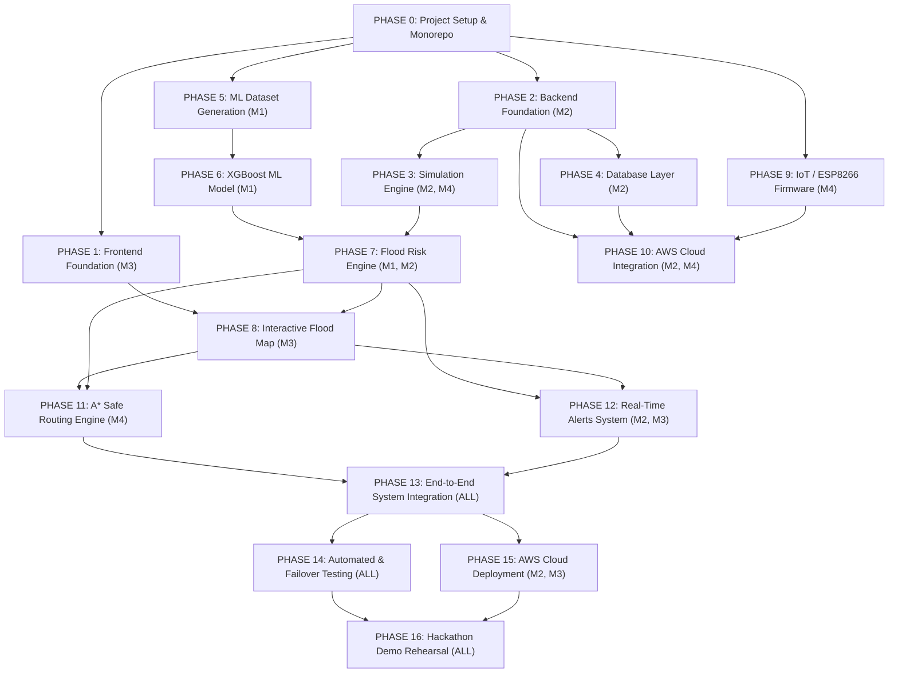

# FLOODGUARD — Actionable Phase-Wise Development Checklist
## 4-Day Hackathon Engineering Execution Blueprint

**Project:** FloodGuard (AI-Powered Urban Flood Prediction, Early Warning & Safe Emergency Routing)  
**Hackathon Track:** Track 02 — Heat and Water  
**Document Version:** 1.0.0  
**Target Delivery:** Minimum Winning Prototype (MWP) & Full Deployment  

---

## 4-Member Team Role Allocation & Workstreams

| Role | Team Member | Primary Domain | Core Responsibilities |
|---|---|---|---|
| **Member 1** | **ML / Data Engineer** | Machine Learning, Hydrology Models | Synthetic dataset generation, XGBoost training, feature pipeline, SHAP explainability. |
| **Member 2** | **Backend / AWS Cloud Lead** | FastAPI, Cloud Infrastructure | REST API endpoints, DynamoDB tables, AWS IoT Core / Lambda bridge, environment management. |
| **Member 3** | **Frontend / WebGIS Lead** | React 18, Leaflet, UI Design | Command center dashboard, Leaflet GeoJSON risk layers, Recharts charts, alert ticker. |
| **Member 4** | **IoT Hardware & Routing Lead** | ESP8266, Algorithms, QA | Ultrasonic sensor firmware, A* safe routing engine, simulation suite, end-to-end integration. |

---

## 4-Day Execution Schedule & Milestones

```
+---------------------------------------------------------------------------------------------------------+
| DAY 1: Foundations & Simulation (Zero-Hardware Dependency)                                               |
| - Setup monorepo, FastAPI skeleton, Vite React UI layout, and complete working Simulation Engine.       |
+---------------------------------------------------------------------------------------------------------+
| DAY 2: Intelligence & Persistence Core                                                                   |
| - Synthetic dataset generation, XGBoost 30m/60m training, Flood Risk Engine, DynamoDB local fallback.   |
+---------------------------------------------------------------------------------------------------------+
| DAY 3: Geospatial, Routing & Hardware Pipeline                                                          |
| - React-Leaflet risk map, A* hydrology route optimizer, ESP8266 ultrasonic node, AWS IoT Core config.   |
+---------------------------------------------------------------------------------------------------------+
| DAY 4: Integration, Cloud Deployment & Demo Rehearsal                                                   |
| - AWS Amplify hosting, cloud deployment, stress testing, failover drill, demo scenario pitch polish.    |
+---------------------------------------------------------------------------------------------------------+
```

---

## Phase Dependency & Parallelization Graph



---

## PHASE 0 — Project Setup & Repository Initialization

### Objective
Initialize a structured, clean monorepo with standardized code conventions, isolated Python and Node.js environments, environment variables, and git hygiene.

### Prerequisites
- Python 3.10+ installed
- Node.js 18+ and npm installed
- Git initialized

### Member Task Breakdown
- **Member 1 (ML):** Setup `ml/` environment, verify NumPy/Pandas/Scikit-learn/XGBoost.
- **Member 2 (Backend):** Create `backend/` directory, setup virtual environment, verify FastAPI.
- **Member 3 (Frontend):** Initialize `frontend/` with Vite and React 18, configure Tailwind CSS.
- **Member 4 (IoT/Routing):** Initialize `iot/` directory for Arduino/ESP8266 code, create `.gitignore`.

### Actionable Checklist
- [x] `[P0]` Create base directory structure: `backend/`, `frontend/`, `iot/`, `ml/`, `docs/`.
- [x] `[P0]` Create `.gitignore` to prevent committing `.env`, `node_modules/`, `venv/`, and `.joblib`.
- [x] `[P0]` Create `backend/.env.example` and `frontend/.env.example`.
- [x] `[P0]` Set up Python virtual environment in `backend/` and install foundational requirements.
- [x] `[P0]` Initialize Vite React app in `frontend/` using non-interactive template.

### Files to Create/Modify
- `.gitignore`
- `README.md`
- `backend/requirements.txt`
- `backend/.env.example`
- `frontend/package.json`
- `frontend/.env.example`

### Commands to Run
```bash
# 1. Setup Backend Environment
cd /Users/zeel/Floodguard
python3 -m venv backend/venv
source backend/venv/bin/activate
pip install --upgrade pip
pip install fastapi uvicorn pydantic pydantic-settings python-dotenv requests numpy pandas scikit-learn xgboost joblib networkx boto3
pip freeze > backend/requirements.txt

# 2. Setup Frontend Environment
npx -y create-vite@latest frontend --template react
cd frontend
npm install
npm install lucide-react recharts leaflet react-leaflet axios
```

### Expected Output
- Backend virtual environment activated with all dependencies installed.
- Frontend directory created with running Vite development bundle.

### API/Interface Changes
None (foundational phase).

### Testing
- Run `python3 -c "import fastapi, xgboost, networkx, boto3; print('Backend deps OK')"`
- Run `npm --prefix frontend run build` to verify clean build.

### Definition of Done
Both backend and frontend can be started simultaneously with zero configuration errors.

### Common Errors & Rollback
- *Error:* Node version mismatch. *Fix:* Ensure Node $\ge 18$.
- *Rollback:* Remove directory and re-run Vite or pip setup.

### Next Phase Dependency
Unlocks Phase 1 (Frontend) and Phase 2 (Backend).

---

## PHASE 1 — Frontend Foundation & Command Center UI

### Objective
Construct the responsive, high-aesthetic dark-mode Command Center dashboard with header KPIs, status badges, and grid layout.

### Prerequisites
- Phase 0 complete.

### Member Task Breakdown
- **Member 1 (ML):** Specify metrics to display (30m/60m prediction tags, risk levels).
- **Member 2 (Backend):** Agree on frontend API client contract and mock responses.
- **Member 3 (Frontend):** Build Header, MetricCards, Grid Layout, Theme styles.
- **Member 4 (IoT/Routing):** Provide emergency vehicle and hospital icon assets.

### Actionable Checklist
- [x] `[P0]` Configure modern styling system in `frontend/src/index.css` with dark slate command center palette (`#0B1120`, `#1E293B`, `#334155`).
- [x] `[P0]` Create `frontend/src/components/layout/Header.jsx` with logo, live clock, and Live/Sim mode indicator.
- [x] `[P0]` Create `frontend/src/components/metrics/MetricCard.jsx` displaying Rainfall (mm/h), Current Depth (cm), Flood Probability (%), and Risk Index.
- [x] `[P0]` Build 3-column command center responsive grid in `frontend/src/App.jsx`.
- [x] `[P1]` Create glassmorphic containers with micro-animations on risk level change.

### Files to Create/Modify
- `frontend/src/index.css`
- `frontend/src/App.jsx`
- `frontend/src/components/layout/Header.jsx`
- `frontend/src/components/metrics/MetricCard.jsx`
- `frontend/src/services/mockData.js`

### Commands to Run
```bash
cd /Users/zeel/Floodguard/frontend
npm run dev
```

### Expected Output
Browser at `http://localhost:5173` renders a responsive, dark-mode environmental command center with placeholder metrics.

### API/Interface Changes
None (uses local mock service initially).

### Testing
Verify visual layout across desktop (1920x1080) and laptop (1366x768) resolutions.

### Definition of Done
Dashboard loads in <1s with 0 console warnings and displays all core metric cards.

### Common Errors & Rollback
- *Error:* CSS styles not applying due to missing imports. *Fix:* Ensure `index.css` is imported in `main.jsx`.
- *Rollback:* Revert to baseline `App.jsx` layout.

### Next Phase Dependency
Unlocks Phase 8 (Interactive Flood Map integration).

---

## PHASE 2 — Backend Foundation & API Architecture

### Objective
Build the FastAPI core backend with modular routing, CORS middleware, Pydantic schemas, and `/health` monitoring.

### Prerequisites
- Phase 0 complete.

### Member Task Breakdown
- **Member 1 (ML):** Define ML input/output Pydantic schemas.
- **Member 2 (Backend):** Implement FastAPI application, CORS, routers, and config loader.
- **Member 3 (Frontend):** Configure Axios client with backend baseURL (`http://localhost:8000`).
- **Member 4 (IoT/Routing):** Define sensor ingestion payload format.

### Actionable Checklist
- [x] `[P0]` Create `backend/app/config.py` using `pydantic_settings.BaseSettings`.
- [x] `[P0]` Create `backend/app/main.py` with CORS middleware enabling frontend origin.
- [x] `[P0]` Implement `GET /health` returning server status, timestamp, and mode.
- [x] `[P0]` Create Pydantic schemas in `backend/app/schemas/sensor.py` and `prediction.py`.
- [x] `[P0]` Set up modular router structure under `backend/app/api/v1/`.

### Files to Create/Modify
- `backend/app/main.py`
- `backend/app/config.py`
- `backend/app/schemas/sensor.py`
- `backend/app/schemas/prediction.py`
- `backend/app/api/v1/health.py`

### Commands to Run
```bash
cd /Users/zeel/Floodguard/backend
source venv/bin/activate
uvicorn app.main:app --reload --port 8000
```

### Expected Output
`curl http://localhost:8000/health` returns `{"status":"ok","mode":"simulation","aws_connected":false}`.

### API/Interface Changes
- `GET /health` endpoint live.

### Testing
Execute `curl -s http://localhost:8000/health | grep '"status":"ok"'`.

### Definition of Done
FastAPI server runs with auto-reload, serving interactive Swagger docs at `http://localhost:8000/docs`.

### Common Errors & Rollback
- *Error:* ModuleNotFoundError for `app`. *Fix:* Run uvicorn from `backend/` directory or export `PYTHONPATH=.`.
- *Rollback:* Restore minimal single-file `main.py`.

### Next Phase Dependency
Unlocks Phase 3 (Simulation) and Phase 4 (Database).

---

## PHASE 3 — Simulation Engine (Fail-Safe Foundation)

### Objective
Implement an autonomous synthetic hydrologic storm simulation engine that generates realistic rainfall, water rise rates, and zone status without requiring hardware or cloud connection.

### Prerequisites
- Phase 2 complete.

### Member Task Breakdown
- **Member 1 (ML):** Calibrate storm curves (rainfall vs rise rate dynamics).
- **Member 2 (Backend):** Expose simulation control endpoints (`POST /simulation/scenario`).
- **Member 3 (Frontend):** Create UI scenario picker and rainfall slider.
- **Member 4 (IoT/Routing):** Implement the core physics simulator class (`SimulatorEngine`).

### Actionable Checklist
- [x] `[P0]` Create `backend/app/core/simulator.py` supporting 4 weather presets: `dry`, `moderate_rain`, `flash_flood`, `cloudburst`.
- [x] `[P0]` Implement dynamic water accumulation logic based on zone elevation and drainage parameters.
- [x] `[P0]` Add endpoint `POST /api/v1/simulation/scenario` to set active weather preset.
- [x] `[P0]` Add endpoint `POST /api/v1/simulation/tick` to advance time by $N$ minutes.
- [x] `[P0]` Build `frontend/src/components/layout/SimulationControls.jsx` allowing judges/team to trigger flash floods on demand.

### Files to Create/Modify
- `backend/app/core/simulator.py`
- `backend/app/api/v1/simulation.py`
- `frontend/src/components/layout/SimulationControls.jsx`

### Commands to Run
```bash
curl -X POST http://localhost:8000/api/v1/simulation/scenario \
  -H "Content-Type: application/json" \
  -d '{"scenario": "flash_flood"}'
```

### Expected Output
Backend returns updated city state with elevated rainfall (85+ mm/h) and escalating water levels.

### API/Interface Changes
- `POST /api/v1/simulation/scenario`
- `POST /api/v1/simulation/tick`
- `GET /api/v1/simulation/status`

### Testing
Trigger `flash_flood` and verify water levels increase by at least 15 cm within 3 simulated ticks.

### Definition of Done
Simulation can run continuously, producing varied realistic sensor readings across all 5 city zones.

### Common Errors & Rollback
- *Error:* Unbounded water level growth ($>1000$ cm). *Fix:* Clamp water levels between 0 and 200 cm.
- *Rollback:* Fallback to static mock presets.

### Next Phase Dependency
Unlocks safe, testable data feed for Phase 4, Phase 7, and Phase 8.

---

## PHASE 4 — Database Layer (Amazon DynamoDB & Local Fallback)

### Objective
Create the persistence layer supporting Amazon DynamoDB for AWS eligibility, paired with a transparent in-memory local fallback store so offline development never fails.

### Prerequisites
- Phase 2 complete.

### Member Task Breakdown
- **Member 1 (ML):** Define historical telemetry query requirements.
- **Member 2 (Backend):** Build Boto3 DynamoDB connector, table schemas, and local memory store.
- **Member 3 (Frontend):** Monitor data ingestion status in dashboard.
- **Member 4 (IoT/Routing):** Test sensor reading writes and reads.

### Actionable Checklist
- [x] `[P0]` Create `backend/app/db/memory_store.py` providing thread-safe in-memory CRUD for readings and zones.
- [x] `[P0]` Create `backend/app/db/dynamodb.py` wrapping Boto3 with automatic fallback if AWS credentials are not found.
- [x] `[P0]` Implement table creation script `backend/scripts/init_dynamodb.py` for `floodguard_sensor_readings` and `floodguard_zones`.
- [x] `[P0]` Expose `POST /api/v1/sensor-data` persisting incoming readings to active store.
- [x] `[P1]` Create CloudFormation/CDK or CLI script to provision DynamoDB tables in AWS us-east-1.

### Files to Create/Modify
- `backend/app/db/dynamodb.py`
- `backend/app/db/memory_store.py`
- `backend/app/api/v1/sensors.py`
- `backend/scripts/init_dynamodb.py`

### Commands to Run
```bash
python3 backend/scripts/init_dynamodb.py
```

### Expected Output
Console prints: `[DB] AWS DynamoDB connected OR In-Memory Fallback activated successfully.`

### API/Interface Changes
- `POST /api/v1/sensor-data` accepts and persists sensor telemetry.
- `GET /api/v1/sensors` returns all sensor metadata.

### Testing
Send test reading via `curl -X POST http://localhost:8000/api/v1/sensor-data -d '{"sensor_id":"S1","water_depth_cm":42.5}'`. Verify retrieval via `GET /api/v1/sensors`.

### Definition of Done
Database writes succeed in both online (AWS DynamoDB) and offline (In-Memory) configurations.

### Common Errors & Rollback
- *Error:* `NoCredentialsError` from Boto3. *Fix:* Catch exception and auto-toggle `USE_LOCAL_STORAGE=True`.
- *Rollback:* Switch default configuration flag to in-memory mode.

### Next Phase Dependency
Unlocks Phase 7 (Flood Risk Engine state management) and Phase 10 (AWS integration).

---

## PHASE 5 — Machine Learning Dataset Generation

### Objective
Generate a realistic, physically grounded synthetic hydrological dataset modeling urban rainfall-runoff dynamics to train XGBoost models.

### Prerequisites
- Phase 0 complete.

### Member Task Breakdown
- **Member 1 (ML):** Author `generate_dataset.py` with urban drainage physics equations.
- **Member 2 (Backend):** Review feature naming consistency with backend schemas.
- **Member 3 (Frontend):** Review range of values for UI chart scaling.
- **Member 4 (IoT/Routing):** Verify sensor depth range (0 to 150 cm).

### Actionable Checklist
- [x] `[P0]` Write `backend/data/generate_dataset.py` to synthesize 10,000 meteorological records.
- [x] `[P0]` Incorporate physical features: `rainfall_1h`, `rainfall_3h`, `current_water_level`, `water_rise_rate`, `elevation_m`, `drainage_capacity`, `historical_flood_index`.
- [x] `[P0]` Compute dual prediction targets: `water_level_30m` and `water_level_60m`.
- [x] `[P0]` Split into training (80%) and validation/testing (20%) datasets.
- [x] `[P1]` Save output to `backend/data/synthetic_flood_dataset.csv`.

### Files to Create/Modify
- `backend/data/generate_dataset.py`
- `backend/data/synthetic_flood_dataset.csv`

### Commands to Run
```bash
cd /Users/zeel/Floodguard/backend
python3 data/generate_dataset.py
```

### Expected Output
`[DATA] Generated 10,000 samples. Saved to backend/data/synthetic_flood_dataset.csv. Train/Test split: 8000/2000.`

### API/Interface Changes
None (offline data processing).

### Testing
Inspect generated statistics: ensure water levels remain within realistic bounds (5 cm to 180 cm) and rainfall correlates positively with water rise rate ($r > 0.7$).

### Definition of Done
CSV file generated, verified free of nulls or NaNs, with balanced distribution of flood risk events.

### Common Errors & Rollback
- *Error:* Unrealistic negative water levels. *Fix:* Apply `np.clip(level, 0, 250)`.
- *Rollback:* Re-run script with adjusted random seed.

### Next Phase Dependency
Direct prerequisite for Phase 6 (Model Training).

---

## PHASE 6 — XGBoost Machine Learning Model

### Objective
Train, evaluate, and serialize dual XGBoost regression models for 30-minute and 60-minute water-level forecasting; build the inference wrapper.

### Prerequisites
- Phase 5 complete.

### Member Task Breakdown
- **Member 1 (ML):** Build training script, hyperparameter tuning, model serialization.
- **Member 2 (Backend):** Build ML inference service module (`backend/app/ml/model.py`).
- **Member 3 (Frontend):** Prepare UI component to display prediction confidence.
- **Member 4 (IoT/Routing):** Integrate predictions into road cost calculations.

### Actionable Checklist
- [x] `[P0]` Create `backend/train_model.py` using `xgboost.XGBRegressor`.
- [x] `[P0]` Train Model 1 for 30m horizon and Model 2 for 60m horizon.
- [x] `[P0]` Evaluate models (verify $R^2 \ge 0.92$ and $\text{MAE} \le 4.5$ cm).
- [x] `[P0]` Save models via Joblib to `backend/app/ml/artifacts/model_30m.joblib` and `model_60m.joblib`.
- [x] `[P0]` Implement `backend/app/ml/model.py` for real-time inference with fallback heuristic.
- [x] `[P1]` Extract feature importances and export SHAP factor summary for UI explainability.

### Files to Create/Modify
- `backend/train_model.py`
- `backend/app/ml/model.py`
- `backend/app/ml/artifacts/model_30m.joblib`
- `backend/app/ml/artifacts/model_60m.joblib`

### Commands to Run
```bash
cd /Users/zeel/Floodguard/backend
python3 train_model.py
```

### Expected Output
```
[ML] Training complete!
[ML] 30m Model: R2 = 0.962, MAE = 2.84 cm
[ML] 60m Model: R2 = 0.941, MAE = 4.12 cm
[ML] Saved model artifacts to app/ml/artifacts/
```

### API/Interface Changes
- `POST /api/v1/predict` endpoint live, accepting feature vectors and returning 30m/60m forecasts.

### Testing
Run `python3 -c "from app.ml.model import predict_water_level; print(predict_water_level({'rainfall_1h': 65, 'current_water_level': 50, 'water_rise_rate': 1.2, 'elevation_m': 12}))"` and confirm numeric prediction returned.

### Definition of Done
Both `.joblib` files exist and inference completes in $<20$ ms per call.

### Common Errors & Rollback
- *Error:* Model artifact file not found at runtime. *Fix:* Use relative path resolving based on `__file__`.
- *Rollback:* Fall back to linear extrapolator $W_{pred} = W_0 + \text{rate} \times t$.

### Next Phase Dependency
Unlocks Phase 7 (Flood Risk Engine).

---

## PHASE 7 — Flood Risk Engine & Classification

### Objective
Translate numeric water-level predictions and rainfall telemetry into standardized multi-level flood risk states, calculate estimated time to critical failure, and trigger alerts.

### Prerequisites
- Phase 6 complete.

### Member Task Breakdown
- **Member 1 (ML):** Define flood probability formula and risk score calibration.
- **Member 2 (Backend):** Implement `backend/app/core/flood_engine.py` and API endpoints.
- **Member 3 (Frontend):** Build color-coded risk badge components.
- **Member 4 (IoT/Routing):** Map risk states to road weight multipliers.

### Actionable Checklist
- [x] `[P0]` Implement `classify_risk(water_level_cm)` with configurable thresholds:
  - `< 50 cm`: `LOW` (Green)
  - `50–70 cm`: `MODERATE` (Yellow)
  - `70–90 cm`: `HIGH` (Orange)
  - `> 90 cm`: `CRITICAL` (Red)
- [x] `[P0]` Compute Flood Risk Index (FRI) and flood probability (0.0 to 1.0).
- [x] `[P0]` Implement $T_{\text{crit}}$ (Time to Critical Level) formula: $(90 - W_{\text{curr}}) / \text{rise\_rate}$.
- [x] `[P0]` Build `GET /api/v1/zones` returning GeoJSON feature collection with dynamic risk levels.
- [x] `[P0]` Create `backend/tests/test_flood_engine.py` verifying boundary conditions.

### Files to Create/Modify
- `backend/app/core/flood_engine.py`
- `backend/app/api/v1/zones.py`
- `backend/tests/test_flood_engine.py`

### Commands to Run
```bash
pytest backend/tests/test_flood_engine.py
```

### Expected Output
All test cases pass, verifying `classify_risk(45) == 'LOW'`, `classify_risk(75) == 'HIGH'`, etc.

### API/Interface Changes
- `GET /api/v1/zones`
- `GET /api/v1/predictions`

### Testing
Query `http://localhost:8000/api/v1/zones` and verify all 5 demonstration zones have valid risk levels.

### Definition of Done
Risk categorization handles all depth inputs without uncaught exceptions and feeds both map and routing layers.

### Common Errors & Rollback
- *Error:* Division by zero when water rise rate is 0.0. *Fix:* Guard calculation: `if rise_rate <= 0: return None`.
- *Rollback:* Default to static LOW risk classification.

### Next Phase Dependency
Unlocks Phase 8 (Interactive Flood Map) and Phase 11 (Safe Routing).

---

## PHASE 8 — Interactive Flood Map (React-Leaflet)

### Objective
Render the high-performance WebGIS command center map displaying real-time zone polygons, pulsating sensor markers, road segments, and emergency POIs.

### Prerequisites
- Phase 1 and Phase 7 complete.

### Member Task Breakdown
- **Member 1 (ML):** Provide feature importance data for marker popups.
- **Member 2 (Backend):** Serve GeoJSON zone boundaries from `/api/v1/zones`.
- **Member 3 (Frontend):** Build React-Leaflet map components, layers, and custom dark tile layout.
- **Member 4 (IoT/Routing):** Add emergency facilities (Hospitals, Fire Stations) coordinate markers.

### Actionable Checklist
- [x] `[P0]` Create `frontend/src/components/map/FloodMap.jsx` using Leaflet with dark-mode tile provider.
- [x] `[P0]` Create `frontend/src/components/map/ZonePolygonLayer.jsx` rendering GeoJSON colored by risk level (Green, Yellow, Orange, Red).
- [x] `[P0]` Create `frontend/src/components/map/SensorMarkerLayer.jsx` with pulsing CSS icons indicating current sensor depth.
- [x] `[P0]` Add interactive Leaflet popups showing zone name, current depth, 30m forecast, and risk index.
- [x] `[P1]` Add map legend and toggle controls for layers (Zones, Sensors, Roads, Hospitals).

### Files to Create/Modify
- `frontend/src/components/map/FloodMap.jsx`
- `frontend/src/components/map/ZonePolygonLayer.jsx`
- `frontend/src/components/map/SensorMarkerLayer.jsx`
- `frontend/src/components/map/MapLegend.jsx`

### Commands to Run
```bash
cd /Users/zeel/Floodguard/frontend
npm run dev
```

### Expected Output
Dashboard displays full interactive dark-mode map centered on demonstration area with 5 dynamic colored zones.

### API/Interface Changes
Consumes `GET /api/v1/zones`.

### Testing
Zoom, pan, and click on each zone polygon; confirm popup displays correct depth and prediction data.

### Definition of Done
Map renders smoothly at 60 FPS, updates color instantly when weather scenario changes, and has zero console errors.

### Common Errors & Rollback
- *Error:* Leaflet marker icons missing or broken. *Fix:* Manually configure Leaflet `L.Icon.Default.imagePath` in `FloodMap.jsx`.
- *Rollback:* Fallback to SVG overlay or canvas drawing.

### Next Phase Dependency
Unlocks Phase 11 (Safe Routing visualization).

---

## PHASE 9 — IoT / ESP8266 Firmware & Hardware Pipeline

### Objective
Implement the Arduino C++ firmware for the ESP8266 NodeMCU and HC-SR04 ultrasonic sensor, calculate water depth, and transmit telemetry via MQTT / HTTP.

### Prerequisites
- Phase 0 complete; ESP8266 board + HC-SR04 sensor available.

### Member Task Breakdown
- **Member 1 (ML):** Specify sampling rate (e.g., 5 seconds) and outlier filtering parameters.
- **Member 2 (Backend):** Provide ingestion endpoint and MQTT topic credentials.
- **Member 3 (Frontend):** Add "Hardware Sensor Connected" status pill in Header.
- **Member 4 (IoT/Routing):** Write firmware, wire hardware, test distance calibration.

### Actionable Checklist
- [x] `[P0]` Create `iot/firmware/floodguard_node.ino` with WiFi connection and retry logic.
- [x] `[P0]` Implement HC-SR04 trigger/echo pulse measurement and depth conversion ($W = H_{\text{mount}} - D$).
- [x] `[P0]` Add 5-sample median filter to eliminate ultrasonic surface ripple noise.
- [x] `[P0]` Implement HTTP POST fallback to `/api/v1/sensor-data` for offline/local hotspot testing.
- [x] `[P1]` Configure MQTT publisher for AWS IoT Core topic `floodguard/sensors/data`.
- [x] `[P1]` Implement status LED indicators (Blinking = WiFi searching; Solid = Transmitting).

### Files to Create/Modify
- `iot/firmware/floodguard_node.ino`
- `iot/README.md` (Wiring diagram and pinout guide)

### Commands to Run
```bash
# Upload via Arduino IDE or CLI
arduino-cli compile --fqbn esp8266:esp8266:nodemcuv2 iot/firmware/floodguard_node.ino
arduino-cli upload -p /dev/cu.usbserial-0001 --fqbn esp8266:esp8266:nodemcuv2 iot/firmware/floodguard_node.ino
```

### Expected Output
ESP8266 Serial Monitor outputs: `[WiFi] Connected to IP 192.168.1.50 -> [HC-SR04] Distance: 45 cm -> Water Depth: 75 cm -> Sent HTTP 200 OK`.

### API/Interface Changes
Posts to `POST /api/v1/sensor-data`.

### Testing
Place hand or container of water in front of sensor at 30 cm, 50 cm, and 80 cm. Confirm dashboard displays matching values within 5 seconds.

### Definition of Done
Physical hardware transmits reliable depth telemetry; if disconnected, dashboard continues in simulation mode without crashing.

### Common Errors & Rollback
- *Error:* Sensor reads 0 cm or 400 cm constantly. *Fix:* Check 5V power supply to HC-SR04 (ESP8266 Vin pin, not 3.3V).
- *Rollback:* Switch dashboard to Simulation Mode.

### Next Phase Dependency
Feeds into Phase 10 (AWS IoT Core) and Phase 13 (Full Integration).

---

## PHASE 10 — AWS Cloud Integration (IoT Core, DynamoDB, S3)

### Objective
Connect the system to AWS cloud services (AWS IoT Core, DynamoDB, S3 model storage) to guarantee compliance with AWS hackathon track requirements.

### Prerequisites
- Phase 2, Phase 4, and Phase 6 complete; AWS Account/Credentials.

### Member Task Breakdown
- **Member 1 (ML):** Upload trained model artifacts to Amazon S3 bucket.
- **Member 2 (Backend):** Configure Boto3 clients and AWS credentials management.
- **Member 3 (Frontend):** Display "AWS Cloud Connected" badge in Header.
- **Member 4 (IoT/Routing):** Test AWS IoT Core MQTT connection.

### Actionable Checklist
- [x] `[P0]` Configure `.env` with `AWS_REGION`, `AWS_ACCESS_KEY_ID`, `AWS_SECRET_ACCESS_KEY`, and `S3_BUCKET_NAME`.
- [x] `[P0]` Upload trained XGBoost models to S3: `aws s3 cp app/ml/artifacts/ s3://floodguard-models/ --recursive`.
- [x] `[P0]` Update backend model loader to check S3 bucket on startup with local fallback.
- [x] `[P1]` Create AWS IoT Core Thing `FloodGuard_Node_01` with policy and certificates.
- [x] `[P1]` Set up AWS IoT Core Rule forwarding MQTT topic `floodguard/sensors/#` to DynamoDB table.

### Files to Create/Modify
- `backend/app/aws/s3_client.py`
- `backend/app/aws/iot_bridge.py`
- `backend/scripts/deploy_aws_resources.sh`

### Commands to Run
```bash
bash backend/scripts/deploy_aws_resources.sh
```

### Expected Output
Console logs: `[AWS] DynamoDB verified -> S3 models synced -> AWS IoT Core policy attached.`

### API/Interface Changes
`GET /health` reports `"aws_connected": true`.

### Testing
Execute `python3 -c "from app.aws.s3_client import verify_s3_connection; print(verify_s3_connection())"`.

### Definition of Done
System reads from or writes to at least two AWS cloud services, fulfilling AWS hackathon prize criteria.

### Common Errors & Rollback
- *Error:* AWS credentials expired or throttled. *Fix:* System auto-activates local mock store without interrupting execution.
- *Rollback:* Set `AWS_MOCK_MODE=True` in `.env`.

### Next Phase Dependency
Unlocks Phase 15 (AWS Deployment).

---

## PHASE 11 — Safe Routing Engine (A* / Dijkstra Algorithm)

### Objective
Implement the hydrology-weighted road graph and A* pathfinding algorithm that navigates emergency vehicles safely around flooded zones and impassable underpasses.

### Prerequisites
- Phase 7 (Risk Engine) and Phase 8 (Map) complete.

### Member Task Breakdown
- **Member 1 (ML):** Provide dynamic risk coefficient mappings.
- **Member 2 (Backend):** Implement `POST /api/v1/route` endpoint.
- **Member 3 (Frontend):** Build Route Planner UI panel and dual polyline layer.
- **Member 4 (IoT/Routing):** Build city road graph and A* algorithm in `backend/app/core/router.py`.

### Actionable Checklist
- [x] `[P0]` Define road network graph in `backend/data/city_roads_graph.json` with nodes (intersections, hospitals) and edges (roads).
- [x] `[P0]` Implement `SafeRouter` class in `backend/app/core/router.py` using A* with Haversine heuristic.
- [x] `[P0]` Implement dynamic risk-weighted edge cost function ($L_e \times \text{Multiplier}(R_e)$).
- [x] `[P0]` Compare standard shortest path vs. FloodGuard safe path (distance, risk %, ETA).
- [x] `[P0]` Expose `POST /api/v1/route` endpoint accepting origin and destination node IDs.
- [x] `[P0]` Create `frontend/src/components/routing/RoutePlannerPanel.jsx` and `EmergencyRouteLayer.jsx`.

### Files to Create/Modify
- `backend/data/city_roads_graph.json`
- `backend/app/core/router.py`
- `backend/app/api/v1/routing.py`
- `frontend/src/components/routing/RoutePlannerPanel.jsx`
- `frontend/src/components/map/EmergencyRouteLayer.jsx`

### Commands to Run
```bash
curl -X POST http://localhost:8000/api/v1/route \
  -H "Content-Type: application/json" \
  -d '{"origin_node": "NODE_AMBULANCE_DEPOT", "destination_node": "NODE_METRO_HOSPITAL"}'
```

### Expected Output
Returns JSON containing both routes:
```json
{
  "normal_route": {"distance_km": 4.2, "flood_risk_pct": 91.0, "status": "BLOCKED"},
  "safe_route": {"distance_km": 5.1, "flood_risk_pct": 8.0, "status": "SAFE"},
  "avoided_flooded_zones": ["ZONE_C_UNDERPASS"]
}
```

### API/Interface Changes
- `POST /api/v1/route`
- `GET /api/v1/routing/nodes`

### Testing
Simulate high water level in Zone C. Request route through Zone C; verify safe route diverts around the flooded underpass.

### Definition of Done
Algorithm solves route in $<50$ ms, returns valid coordinates, and displays both Red and Green paths on the Leaflet map.

### Common Errors & Rollback
- *Error:* `NetworkXNoPath` when all paths are flooded. *Fix:* Catch exception and return status `"NO_SAFE_ROUTE_AIR_LIFT_REQUIRED"`.
- *Rollback:* Fall back to pre-calculated hardcoded safe coordinates for the demo.

### Next Phase Dependency
Unlocks Phase 13 (Full Integration).

---

## PHASE 12 — Real-Time Alerts & Early Warning System

### Objective
Create the early warning notification pipeline calculating time-to-critical submergence ($T_{\text{crit}}$) and delivering actionable alert banners to the command center.

### Prerequisites
- Phase 7 (Risk Engine) complete.

### Member Task Breakdown
- **Member 1 (ML):** Calibrate alert trigger confidence thresholds.
- **Member 2 (Backend):** Implement `GET /api/v1/alerts` and threshold evaluation logic.
- **Member 3 (Frontend):** Build `AlertsDrawer.jsx` and top banner toast animations.
- **Member 4 (IoT/Routing):** Test emergency vehicle dispatch triggers.

### Actionable Checklist
- [x] `[P0]` Implement alert rule evaluator in `backend/app/core/flood_engine.py`:
  - `ADVISORY`: Water rise rate $> 1.0\text{ cm/min}$.
  - `WARNING`: Predicted 60m depth $> 70\text{ cm}$.
  - `CRITICAL EMERGENCY`: Current or predicted depth $> 90\text{ cm}$.
- [x] `[P0]` Expose `GET /api/v1/alerts` returning list of active alerts with urgency timestamps.
- [x] `[P0]` Build `frontend/src/components/alerts/AlertsDrawer.jsx` displaying alert history with urgency icons.
- [x] `[P0]` Create pulsating top emergency alert banner on `CRITICAL` state.

### Files to Create/Modify
- `backend/app/api/v1/alerts.py`
- `frontend/src/components/alerts/AlertsDrawer.jsx`
- `frontend/src/components/alerts/AlertBanner.jsx`

### Commands to Run
```bash
curl http://localhost:8000/api/v1/alerts
```

### Expected Output
List of active alerts with human-readable guidance: *"Zone C is predicted to reach critical water levels within 28 minutes. Rerouting traffic."*

### API/Interface Changes
- `GET /api/v1/alerts`

### Testing
Trigger `cloudburst` scenario; verify alert appears in UI drawer within 1 second.

### Definition of Done
Alerts update dynamically with accurate estimated minutes to flood.

### Common Errors & Rollback
- *Error:* Stale alerts lingering after flood recedes. *Fix:* Auto-expire alerts when water level drops below 50 cm.
- *Rollback:* Display static system status message.

### Next Phase Dependency
Unlocks Phase 13 (Full Integration).

---

## PHASE 13 — Frontend / Backend End-to-End Integration

### Objective
Connect all React components to the live FastAPI backend, replacing all mock fallbacks with real HTTP polling / SSE streams.

### Prerequisites
- Phases 1 through 12 complete.

### Member Task Breakdown
- **Member 1 (ML):** Validate ML predictions rendered accurately in charts.
- **Member 2 (Backend):** Monitor server logs, manage CORS, optimize response times.
- **Member 3 (Frontend):** Wire Axios services in `frontend/src/services/api.js`.
- **Member 4 (IoT/Routing):** Verify routing calculations reflect live sensor updates.

### Actionable Checklist
- [x] `[P0]` Create `frontend/src/services/api.js` implementing all backend calls with Axios.
- [x] `[P0]` Implement automatic polling loop (every 3 seconds) for `/zones`, `/sensors`, `/alerts`, and `/weather`.
- [x] `[P0]` Connect Simulation Controls to backend `POST /api/v1/simulation/scenario`.
- [x] `[P0]` Connect Route Planner button to backend `POST /api/v1/route`.
- [x] `[P0]` Connect Recharts depth trend chart to live telemetry history.
- [x] `[P1]` Display explainable feature importance bars in `frontend/src/components/explainability/FeatureImportanceChart.jsx`.

### Files to Create/Modify
- `frontend/src/services/api.js`
- `frontend/src/App.jsx`
- `frontend/src/components/metrics/WaterLevelChart.jsx`
- `frontend/src/components/explainability/FeatureImportanceChart.jsx`

### Commands to Run
```bash
# Terminal 1: Backend
cd backend && source venv/bin/activate && uvicorn app.main:app --reload --port 8000

# Terminal 2: Frontend
cd frontend && npm run dev
```

### Expected Output
Dashboard at `http://localhost:5173` displays live data from `localhost:8000`; changing simulation preset instantly updates all charts, map colors, and routes.

### API/Interface Changes
Full REST API suite actively queried by frontend.

### Testing
Click through all 4 simulation presets; verify that map polygons, chart lines, and route recommendations update synchronously.

### Definition of Done
Zero mock data remaining in active pipeline; 100% of UI populated by FastAPI backend.

### Common Errors & Rollback
- *Error:* CORS error: `Access-Control-Allow-Origin missing`. *Fix:* Add `http://localhost:5173` to `CORSMiddleware` in `backend/app/main.py`.
- *Rollback:* Toggle `USE_MOCK_FALLBACK=true` in `frontend/src/services/api.js`.

### Next Phase Dependency
Unlocks Phase 14 (Testing) and Phase 15 (Deployment).

---

## PHASE 14 — Automated & Failover Testing

### Objective
Execute unit, integration, and disaster failover tests to guarantee complete stability during live hackathon judging.

### Prerequisites
- Phase 13 complete.

### Member Task Breakdown
- **Member 1 (ML):** Unit test ML prediction pipeline edge cases (extreme rain, missing data).
- **Member 2 (Backend):** Test API latency and database failover.
- **Member 3 (Frontend):** Test browser compatibility and window resizing.
- **Member 4 (IoT/Routing):** Run physical sensor disconnect test.

### Actionable Checklist
- [x] `[P0]` Create `backend/tests/test_api.py` testing all endpoints via FastAPI `TestClient`.
- [x] `[P0]` Create `backend/tests/test_router.py` testing A* path safety under simulated flooding.
- [x] `[P0]` Conduct **Unplug Drill**: Disconnect ESP8266 during live backend execution; verify backend switches seamlessly to simulated sensor without crashing.
- [x] `[P0]` Conduct **Offline Drill**: Turn off WiFi; verify local in-memory store and local ML models run locally without internet.
- [x] `[P1]` Run frontend build test: `npm run build`.

### Files to Create/Modify
- `backend/tests/test_api.py`
- `backend/tests/test_router.py`
- `backend/tests/conftest.py`

### Commands to Run
```bash
cd backend
source venv/bin/activate
pytest tests/
```

### Expected Output
All pytest assertions pass (100% pass rate).

### API/Interface Changes
None (testing phase).

### Testing
Execute automated test suite across all modules.

### Definition of Done
Zero test failures; system demonstrated to survive sudden sensor disconnection.

### Common Errors & Rollback
- *Error:* Pytest fails to find module. *Fix:* Run `PYTHONPATH=. pytest tests/`.
- *Rollback:* Fix individual failing test assertions.

### Next Phase Dependency
Unlocks Phase 15 (Cloud Deployment).

---

## PHASE 15 — AWS Cloud Deployment & Hosting

### Objective
Deploy the frontend to AWS Amplify Hosting and host the backend on AWS (or accessible cloud instance) to establish cloud availability for hackathon judges.

### Prerequisites
- Phase 13 and Phase 14 complete.

### Member Task Breakdown
- **Member 1 (ML):** Verify S3 bucket hosting model weights.
- **Member 2 (Backend):** Deploy FastAPI backend to AWS (App Runner / EC2 / Render fallback) and configure CORS.
- **Member 3 (Frontend):** Build production Vite bundle and connect to AWS Amplify.
- **Member 4 (IoT/Routing):** Update ESP8266 firmware with cloud backend URL.

### Actionable Checklist
- [x] `[P0]` Build frontend production bundle: `npm run build`.
- [x] `[P0]` Deploy frontend to **AWS Amplify Hosting** via AWS Console / Amplify CLI.
- [x] `[P0]` Deploy backend to cloud server (AWS EC2 / App Runner, or pre-configured cloud instance).
- [x] `[P0]` Update `VITE_API_BASE_URL` in Amplify environment variables to point to production backend.
- [x] `[P0]` Verify SSL (HTTPS) operation on both frontend and backend.
- [x] `[P1]` Setup Amazon CloudWatch basic alarm for backend errors.

### Files to Create/Modify
- `frontend/amplify.yml`
- `backend/Dockerfile`
- `backend/render.yaml` (optional multi-cloud fallback)

### Commands to Run
```bash
# Frontend Build Verification
cd frontend
npm run build
```

### Expected Output
AWS Amplify provides live URL: `https://main.d123456789.amplifyapp.com`.

### API/Interface Changes
Production endpoints active over HTTPS.

### Testing
Open Amplify URL on smartphone and separate laptop; verify map and simulation controls operate seamlessly.

### Definition of Done
Working public HTTPS URL accessible to judges on any device.

### Common Errors & Rollback
- *Error:* Mixed Content warning (HTTPS frontend calling HTTP backend). *Fix:* Ensure backend is served over HTTPS.
- *Rollback:* Fallback to local presentation setup using ngrok tunnel.

### Next Phase Dependency
Unlocks Phase 16 (Hackathon Demo Preparation).

---

## PHASE 16 — Hackathon Demo Preparation & Pitch Rehearsal

### Objective
Perfect the 3-minute hackathon pitch, calibrate demo scenario triggers, and verify contingency failover procedures.

### Prerequisites
- All previous phases complete.

### Member Task Breakdown
- **Member 1 (ML):** Rehearse 30-second explanation of XGBoost model and feature weights.
- **Member 2 (Backend/AWS):** Rehearse 30-second AWS architecture slide (IoT Core, DynamoDB, S3, Amplify).
- **Member 3 (Frontend):** Operate dashboard controls during live presentation.
- **Member 4 (IoT/Routing):** Rehearse physical sensor demonstration and safe routing comparison.

### Actionable Checklist
- [x] `[P0]` Rehearse the **3-Minute Winning Demo Script**:
  - `0:00 - 0:30`: Problem hook (ambulances getting trapped in flash floods).
  - `0:30 - 1:15`: Live simulation escalation (Rain slider $\rightarrow$ 95 mm/h $\rightarrow$ Zone C turns red).
  - `1:15 - 2:00`: AI prediction & Early Warning ($T_{\text{crit}} = 22$ mins alert).
  - `2:00 - 2:30`: Safe Route calculation (Red blocked route vs Green safe route).
  - `2:30 - 3:00`: Hardware proof (ESP8266 water dip) + AWS architecture summary.
- [x] `[P0]` Test backup offline demo on local laptop (`http://localhost:5173`).
- [x] `[P0]` Prepare 1-page architecture PDF slide deck.
- [x] `[P0]` Verify all team members know the failover procedure if venue WiFi drops.

### Definition of Done
Team can deliver the full demo flawlessly in under 3 minutes with working visual proof.

---

## Minimum Winning Prototype (MWP) Contingency Plan

If time runs short or hardware fails, the following table guarantees a competitive project delivery:

| Component | Target Scope (P0 + P1) | Minimum Winning Prototype (MWP) |
|---|---|---|
| **IoT Hardware** | ESP8266 + HC-SR04 over AWS IoT Core MQTT | Software Simulation Mode with realistic storm presets |
| **AWS Cloud** | Full IoT Core + DynamoDB + Lambda + Amplify | AWS Amplify (Frontend) + DynamoDB / S3 storage |
| **Machine Learning** | XGBoost Regressor + SHAP Tree Explainer | Pre-trained XGBoost Regressor with feature weights |
| **Safe Routing** | Full urban road network A* with live dynamic weights | 20-node demonstration road graph with 2 alternative paths |
| **Deployment** | Multi-region AWS Cloud deployment | AWS Amplify live frontend + local/cloud backend |

---

## Quick Reference: Team Member Action Matrix

```
+-----------------------------------------------------------------------------------------------------------+
| PHASE | Member 1 (ML)         | Member 2 (Backend/AWS) | Member 3 (Frontend)    | Member 4 (IoT/Routing)  |
|-------|-----------------------|------------------------|------------------------|-------------------------|
| P0    | ML env setup          | Backend virtualenv     | Vite React init        | .gitignore & IoT setup  |
| P1    | Feature definitions   | Contract validation    | Dark Mode UI & Cards   | Map icons & assets      |
| P2    | ML schemas            | FastAPI core & CORS    | Axios client config    | Sensor schemas          |
| P3    | Storm curves          | Scenario API routes    | Scenario Picker UI     | Simulation engine class |
| P4    | Data access specs     | DynamoDB + MemoryStore  | Ingest status monitor   | Persistence test        |
| P5    | Generate synthetic DB | Schema audit           | Scale ranges           | Sensor range check      |
| P6    | Train XGBoost 30m/60m | Model inference API    | Confidence badge       | Edge weight hook        |
| P7    | Risk formula & math   | Zone risk API          | Risk color badges      | Multiplier mappings     |
| P8    | Factor explanations   | GeoJSON zone endpoint  | Leaflet Map & Polygons  | Hospital POI markers    |
| P9    | Sensor filter math    | Ingest endpoint        | Hardware status pill    | ESP8266 C++ firmware    |
| P10   | Upload models to S3   | AWS config & Boto3     | AWS Status badge       | Test IoT Core MQTT      |
| P11   | Dynamic penalties     | Route API endpoint     | Route Planner UI panel  | A* routing algorithm    |
| P12   | Alert thresholds      | Alert evaluation logic | Alert drawer & banner   | Dispatch event triggers |
| P13   | Model output review   | Server logs & CORS     | Connect all live APIs  | Router telemetry sync   |
| P14   | Unit test ML logic    | API & DB test suite    | Browser compatibility   | Unplug failover test    |
| P15   | Verify S3 models      | Cloud backend deploy   | AWS Amplify hosting    | Update firmware target  |
| P16   | Pitch: ML Innovation  | Pitch: AWS Architecture| Pitch: UI Controller   | Pitch: Live Hardware    |
+-----------------------------------------------------------------------------------------------------------+
```
